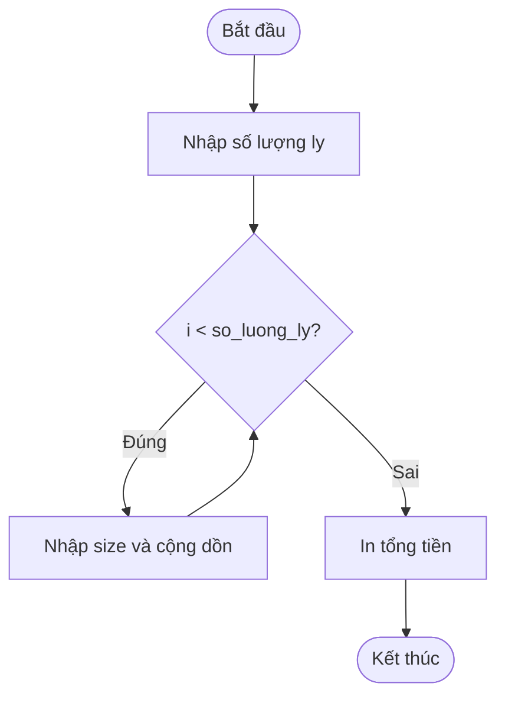

# Báo cáo phân tích và sửa lỗi vòng lặp tính tiền POS Coffee

> 👤 **Học viên:** Hoàng Công Dũng | **Mã SV:** PTIT-HCM-009
> 🏫 **Môn học:** it102-rl-hoangcongdung

---

## 📊 Sơ đồ thiết kế hệ thống (Flowchart)

> 💡 *Sơ đồ dưới đây được render tự động trực tiếp trên GitHub bằng Mermaid. Bạn cũng có thể tải file **`bt1.drawio`** trong repository này để mở và chỉnh sửa trực tiếp trên [Draw.io (diagrams.net)](https://app.diagrams.net).* 

---

## 1. Phân tích nguyên nhân lỗi sai (AS-IS)

Sau khi kiểm tra đoạn mã nguồn pos_order.c hiện tại, tôi nhận thấy lỗi gây ra sự cố thất thu doanh thu là lỗi lệch một đơn vị (Off-by-one error) nằm ở điều kiện của vòng lặp for.

Cụ thể, vòng lặp đang viết là 'for (int i = 1; i < so_luong_ly; i++)'. Khi thu ngân nhập số lượng là 3 ly, biến i lần lượt nhận các giá trị 1 và 2. Khi i đạt giá trị 3, điều kiện '3 < 3' trả về giá trị sai (false), do đó vòng lặp kết thúc ngay lập tức mà không cho phép nhập thông tin cho ly thứ 3.

- Lỗi logic: Biến chạy khởi tạo từ 1 và sử dụng phép so sánh nghiêm ngặt bé hơn (<) thay vì bé hơn hoặc bằng (<=).
- Hậu quả nghiệp vụ: Đơn hàng nhiều ly luôn bị bỏ sót ly cuối cùng, dẫn đến thâm hụt tiền thu của quán.

## 2. Bảng Test Cases đối chứng

Dưới đây là bảng kiểm thử đối chứng trước và sau khi sửa lỗi logic của vòng lặp:

| Trường hợp kiểm thử | Dữ liệu đầu vào (Số lượng ly) | Kết quả sai thực tế (Mã cũ) | Kết quả đúng mong đợi (Mã mới) |
| --- | --- | --- | --- |
| Test 1: Đơn hàng 1 ly | 1 ly (Size S) | Vòng lặp không chạy, Tổng tiền = 0 VNĐ | Chạy đúng 1 lần, Tổng tiền = 30.000 VNĐ |
| Test 2: Đơn hàng 3 ly | 3 ly (S, M, L) | Chỉ tính 2 ly đầu, bỏ sót ly cuối | Chính xác cả 3 ly: 30k + 36k + 40k = 106.000 VNĐ |
| Test 3: Đơn hàng 5 ly | 5 ly (Toàn Size S) | Chỉ tính 4 ly (120.000 VNĐ) | Tính đủ 5 ly (150.000 VNĐ) |

## 3. Phương án khắc phục

Để khắc phục triệt để lỗi trên, ta cần sửa lại điều kiện trong vòng lặp for thành 'for (int i = 1; i <= so_luong_ly; i++)' hoặc thay đổi điểm bắt đầu chỉ số biến i từ 0 và điều kiện 'i < so_luong_ly'. Ở đây tôi chọn phương án giữ nguyên hiển thị 'Ly thứ %d' theo đúng giao diện hiện tại bằng cách sửa dấu so sánh thành bé hơn hoặc bằng (<=).

- Đảm bảo biên dịch thành công bằng lệnh: gcc -std=c11 pos_order.c -o pos_order
- Tuân thủ đúng các kiểu dữ liệu cơ bản, không sử dụng thư viện ngoài.

---

## 📁 Danh sách tệp tin nộp bài trong Repository
- 📝 `bt1.docx`: Báo cáo tài liệu phân tích nghiệp vụ hoàn chỉnh.
- 🎨 `bt1.drawio`: File thiết kế sơ đồ chuẩn theo quy định đề bài (mở trực tiếp bằng [Draw.io](https://app.diagrams.net) hoặc Lucidchart).
- 💻 `pos_order.c`: Mã nguồn chương trình.
